# Microservices Concepts Guide

A revision guide for the concepts used in the Hotel Rating project, written at the level a senior backend engineer is expected to know.
Each topic covers: **what it is, why it exists, how it works, how we use it here, what a senior engineer should know, and common pitfalls.**
For the chronological log of what was built and when, see `LEARNING_NOTES.md`.

> Diagrams are written in Mermaid. They render automatically on GitHub. In IntelliJ, the Markdown preview shows them once the Mermaid extension is enabled (Settings > Languages & Frameworks > Markdown). Otherwise the diagram source is still readable as text.

**Contents**
0. [Core principles](#0-core-principles)
1. [Service Discovery (Eureka)](#1-service-discovery-eureka)
2. [Inter-service communication (OpenFeign)](#2-inter-service-communication-openfeign)
3. [Centralized configuration (Config Server)](#3-centralized-configuration-config-server)
4. [API Gateway](#4-api-gateway)
5. [Resilience (Resilience4j)](#5-resilience-resilience4j) (in progress)

---

## 0. Core principles

These explain *why* the tools below exist.

**The system as it stands today**
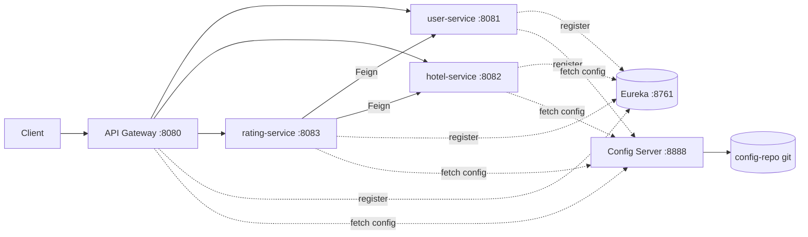
Solid arrows are request traffic. Dotted arrows are startup and background traffic.

- **Each service owns its data.** One database per service. No other service reads its tables. Data is shared only through APIs or events.
- **The network is unreliable.** A call to another service can be slow, fail, time out, or succeed after the caller gave up. Every remote call needs a timeout and a failure plan.
- **Failure is normal.** Design for partial failure: one broken service should not take the system down.
- **Consistency is relaxed.** Across services there are no ACID transactions. Data is *eventually consistent*, and cross-service changes use patterns such as Saga (later phase).
- **Retried requests must be safe.** Operations that may be repeated should be **idempotent** (doing it twice has the same effect as once).
- **Cost of microservices:** more moving parts, network latency, harder debugging and testing. They solve team and scaling problems, not code-quality problems.

---

## 1. Service Discovery (Eureka)

### What and why
Service A needs to call service B. Hard-coding `http://localhost:8082` breaks when the port changes, the service moves, or there are several instances. A **registry** keeps a live list of service instances so callers look them up by **name**.

### How it works
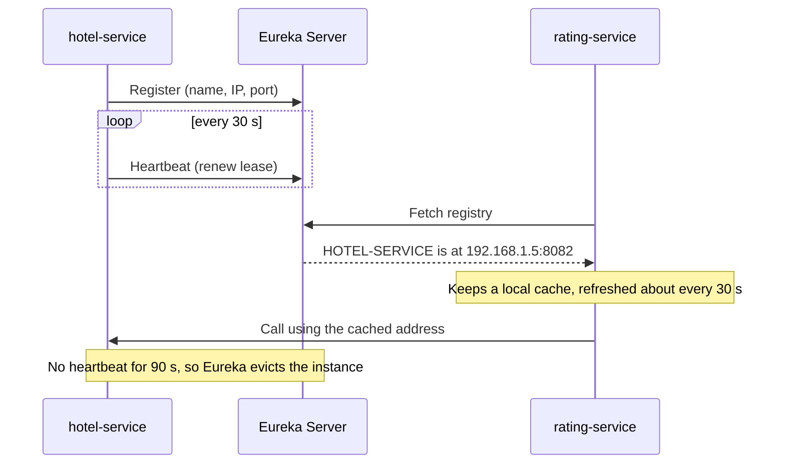
1. On startup a service **registers** its name, host/IP and port.
2. It sends a **heartbeat (lease renewal) every 30 s**.
3. If Eureka gets no heartbeat for **90 s**, it evicts the instance.
4. Clients **fetch the registry and cache it locally**, refreshing about every 30 s. Calls are resolved from this local cache, so a Eureka outage does not stop calls to already-known instances.

### Client-side vs server-side discovery
- **Client-side (Eureka):** the caller gets the list of instances and picks one itself (load balancing in the client).
- **Server-side (Kubernetes, cloud load balancers):** the caller calls one stable address and the platform routes it. On Kubernetes you usually drop Eureka and use the platform's service discovery.

### In this project
- `service-registry` runs Eureka on port **8761**; dashboard at http://localhost:8761.
- Every service has the Eureka client and `eureka.client.service-url.defaultZone=http://localhost:8761/eureka`.
- `eureka.instance.prefer-ip-address=true` registers the IP instead of the machine hostname.

### What a senior engineer should know
- **Eureka favours availability over consistency (AP).** Its data can be stale: a stopped service can stay in client caches for up to about 90 s plus cache refresh time. Callers must handle calls to dead instances (retry, circuit breaker).
- **Self-preservation mode** (red "EMERGENCY" banner): if heartbeats fall below about 85% of the expected number, Eureka stops evicting, assuming a network problem. Common and harmless in small local setups. Do not disable it in production.
- **High availability:** run several Eureka servers that replicate to each other (peer awareness). A single Eureka is a single point of failure for *new* lookups, though cached clients keep working.
- **Health:** by default Eureka reports an instance UP if it is sending heartbeats, even if its database is down. Health checks can be tied to the Actuator health endpoint.
- **Graceful shutdown** deregisters the instance. A killed process leaves a stale entry until the lease expires.

### Pitfalls
- Registering `localhost` or the wrong network interface in containers or multi-NIC machines.
- Assuming a registry entry means the instance is healthy.
- Forgetting that discovery adds startup-order dependencies (registry first).

---

## 2. Inter-service communication (OpenFeign)

### What and why
Hand-written HTTP calls (building URLs, parsing JSON) are repetitive. With OpenFeign you declare an **interface** and Feign generates the HTTP client.

```java
@FeignClient(name = "HOTEL-SERVICE")
public interface HotelService {
    @GetMapping("/api/v1/hotel/{id}")
    HotelResponse getHotel(@PathVariable String id);
}
```

### How it works
- `name = "HOTEL-SERVICE"` is a service name, not a URL. Feign asks the **Spring Cloud LoadBalancer**, which gets instances from Eureka and picks one (round-robin by default).
- This is **synchronous** communication: the caller's thread waits for the response.

**What happens during the rating-details call**
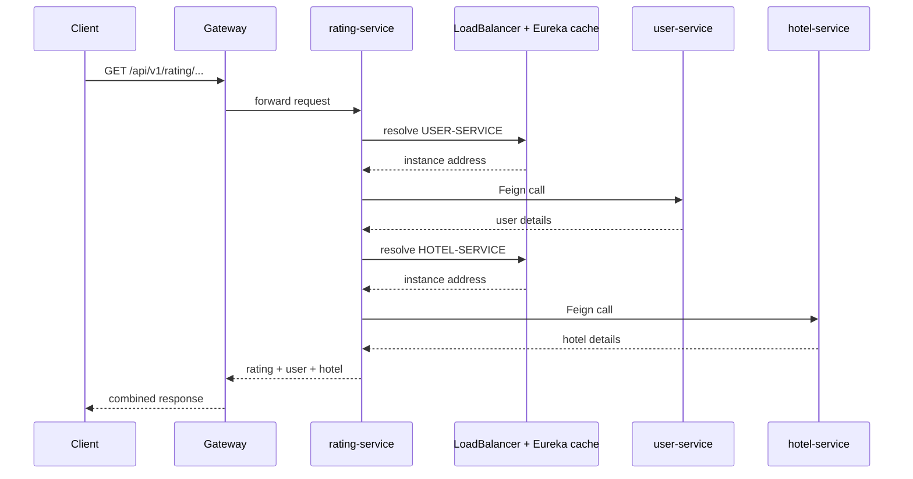
The client's total wait is the sum of both Feign calls here, and the request fails if either one fails. Availability multiplies along a chain: three services at 99.9% each give roughly 99.7% overall.

### In this project
The rating-details API in rating-service calls user-service and hotel-service through Feign and combines the results (the **service composition** pattern).

### What a senior engineer should know
- **Timeouts:** Spring Cloud OpenFeign defaults are about **10 s connect and 60 s read**. That is far too long for most calls, because threads sit blocked for a minute. Set them explicitly per client.
- **Retries:** Feign's own retryer is **off by default** in Spring Cloud OpenFeign. If you add retries, only retry **idempotent** calls (GET, or POST with an idempotency key).
- **Errors:** a non-2xx response throws `FeignException`. Use a custom `ErrorDecoder` to map status codes to meaningful exceptions (for example 404 to "not found") instead of leaking raw Feign errors.
- **Fallbacks:** `@FeignClient(fallback = ...)` or `fallbackFactory` (which also gives access to the cause) when a circuit breaker is enabled (topic 5).
- **Header propagation:** use a `RequestInterceptor` to forward things such as the auth token and a correlation ID to downstream calls.
- **Logging:** set Feign logger level (`BASIC`/`FULL`) per client while debugging.
- **Coupling:** synchronous calls create runtime coupling. If B is down, A's request fails. Long call chains multiply latency and failure probability. Prefer events (later phase) when the caller does not need an immediate answer.
- **The N+1 problem:** calling another service once per item in a list is slow. Prefer a batch endpoint.
- **Contract sharing:** the DTO a client expects must match what the provider returns. Changing a provider's response can break callers, so evolve APIs compatibly (add fields, don't remove or rename).
- Alternatives: `RestClient` or HTTP interface clients (`@HttpExchange`) in current Spring versions. Feign remains very common in Spring Cloud projects.

### Pitfalls
- Leaving default timeouts.
- Retrying non-idempotent calls, which can create duplicates.
- Treating a remote call like a local method call.

---

## 3. Centralized configuration (Config Server)

### What and why
Each service had its own `application.properties` with duplicated Eureka settings and DB credentials. The **Config Server** serves configuration over HTTP from a **git repo** (`config-repo`), so shared settings live in one place, are versioned, and differ per environment.

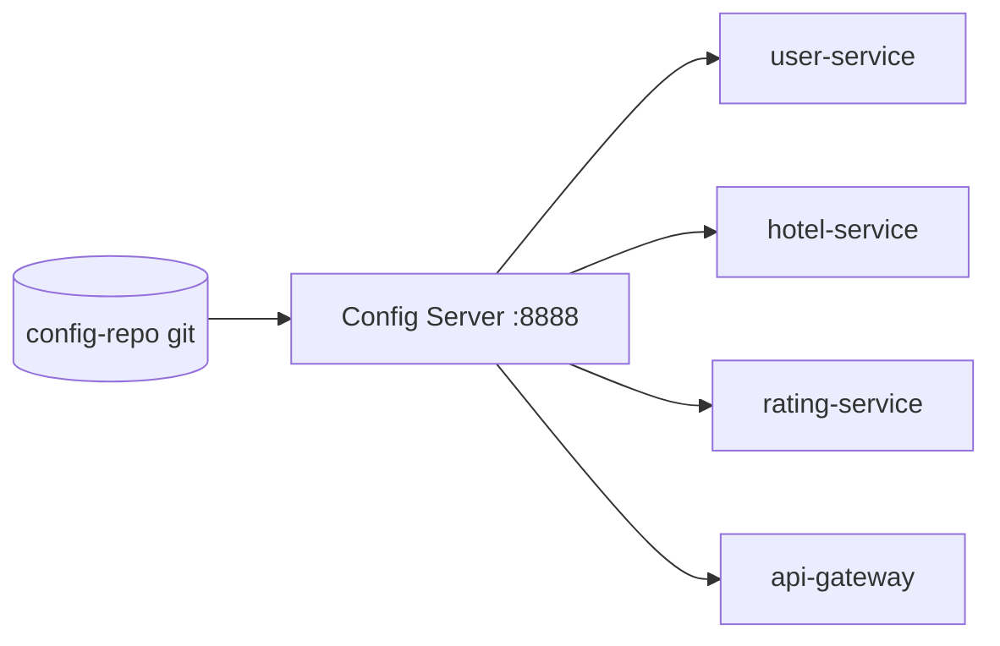

### How resolution works
A client asks for `{application}/{profile}/{label}`: its `spring.application.name`, active profile(s), and git branch (default `main` here).

| File in the config repo | Applies to |
|---|---|
| `application.properties` | all services |
| `user-service.properties` | only user-service |
| `user-service-dev.properties` | user-service when profile `dev` is active |

More specific files **override** more general ones. Inspect the result at `http://localhost:8888/user-service/dev`; `propertySources` lists sources from highest to lowest priority.

**Which value wins** (top wins)
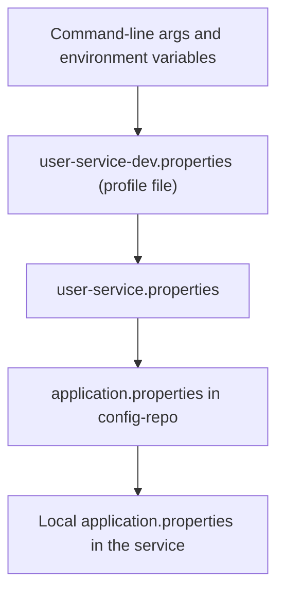

### Making a service a client
1. Add `spring-cloud-starter-config` to the pom.
2. Local `application.properties` keeps only:
   ```properties
   spring.application.name=user-service
   spring.config.import=configserver:http://localhost:8888
   ```
3. At startup the service fetches its config and merges it into its environment. **Application code does not change.**

**What happens when a service starts**
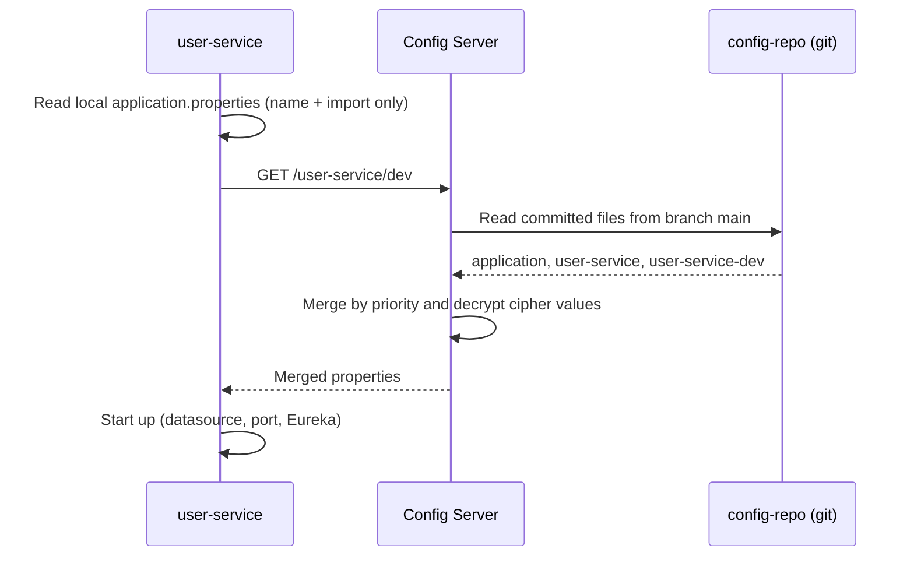

### In this project
- `config-server` on **8888**, registered in Eureka too (clients still find it by fixed URL).
- Profiles: `user-service-dev` / `-prod` activate with `spring.profiles.active` or the `SPRING_PROFILES_ACTIVE` environment variable.
- The DB password is stored as `{cipher}<hex>`; the key comes from the `ENCRYPT_KEY` environment variable.

### What a senior engineer should know
- **Precedence:** imported config from the server overrides the local `application.properties`. Environment variables and command-line arguments still win over both by default.
- **`optional:` vs required import:** with `optional:configserver:` a service starts even if the server is unreachable, silently using defaults, which can hide misconfiguration. Without `optional:` startup fails fast. Prefer fail-fast for services that cannot run without config.
- **The Config Server is a startup dependency** and a possible single point of failure. Run several instances behind a load balancer or discovery, and keep fail-fast or retry settings sensible.
- **Config is read at startup.** Changing a value needs one of: a restart; `POST /actuator/refresh` with `@RefreshScope` beans (per instance); or **Spring Cloud Bus** (broadcast refresh through a message broker). Things such as the DataSource and `server.port` need a restart.
- **Encryption:** the server can store `{cipher}` values and decrypt them for clients. Symmetric key (`encrypt.key`) is simplest; an RSA keystore is stronger. For real systems use a secrets manager such as **HashiCorp Vault** or cloud secret stores, and never commit the key.
- **Secure the Config Server itself:** it exposes config and (if enabled) `/encrypt` and `/decrypt`. Put it behind authentication and keep it off the public internet.
- **Environments:** one config repo with profile files, or one branch/label per environment. Keep prod access to the repo restricted.
- **The 12-factor idea:** config belongs in the environment, not in the code or the built artifact. The same build should run in dev and prod with different config.
- **Alternatives:** Kubernetes ConfigMaps and Secrets, Consul, cloud config services.

### Pitfalls we hit
| Symptom | Cause |
|---|---|
| Empty `propertySources` | Files named `*.properties.txt` (Windows hid the extension) |
| `NoSuchLabelException` | Wrong branch in `default-label` (`main` vs `master`) |
| `Failed to configure a DataSource` | Missing `spring-cloud-starter-config` dependency, with `optional:` hiding the failure |
| Password still shows as hex | Missing `{cipher}` prefix |
| Change not visible | Config repo change not **committed** (the server serves committed files only) |

---

## 4. API Gateway

### What and why
Without a gateway, clients need every service's address, and cross-cutting concerns (auth, CORS, rate limiting, logging) get built in every service. The **gateway** is the single public entry point. It matches a request, applies filters, and forwards it to the right service.

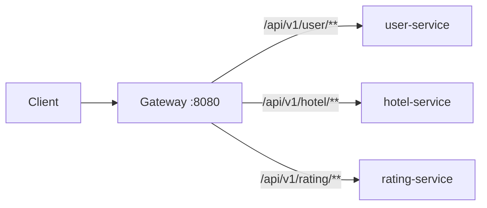

### Route anatomy
- **id:** a unique name.
- **uri:** the target. `lb://USER-SERVICE` means "look up USER-SERVICE in Eureka and load-balance".
- **predicates:** conditions to match (`Path=/api/v1/user/**`, also Method, Header, Host, etc.).
- **filters:** change the request before forwarding or the response after (add or strip headers, `StripPrefix`, `RewritePath`, rate limiting, circuit breaker, retry).

**Life of a request through the gateway**
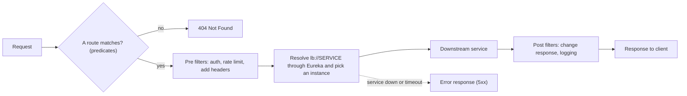

### In this project
- `api-gateway` on **8080**, routes in `config-repo/api-gateway.properties`.
- With Spring Cloud 2025.x the property prefix is `spring.cloud.gateway.server.webflux`. Older tutorials using `spring.cloud.gateway.routes` will not work.
- The gateway is **reactive** (WebFlux/Netty), so it does not use Spring Web.

### What a senior engineer should know
- **What belongs in a gateway:** routing, authentication/token validation, rate limiting, CORS, request logging and correlation IDs, coarse circuit breaking. **Not** business logic or heavy data aggregation: that makes it a bottleneck and a mini-monolith.
- **Gateway vs load balancer vs service mesh:** a load balancer spreads traffic across instances of one thing; a gateway routes *by path or rule to different services* and applies API-level policies; a service mesh handles service-to-service traffic. Production setups often put a load balancer in front of several gateway instances.
- **It is a single point of failure and a hot path.** Keep it stateless and run several instances. Every request pays its added latency.
- **Timeouts:** configure connect and response timeouts (`...httpclient.connect-timeout`, `...httpclient.response-timeout`) so a slow service doesn't hold gateway connections. The gateway's timeout should be larger than the downstream service's own timeouts.
- **Rate limiting** (`RequestRateLimiter`) needs a shared store, typically Redis, to work across gateway instances.
- **Security:** validate the JWT at the gateway, then pass identity downstream. Do not rely on the gateway alone: services should not be reachable directly from outside (network rules), and ideally verify tokens too.
- **Cross-cutting filters** can be global (apply to all routes) or per route.
- **BFF (Backend For Frontend):** sometimes you run one gateway per client type (web, mobile) with tailored responses.
- Two variants exist: WebFlux (reactive, used here) and WebMVC (servlet-based).

### Observed in this project
With hotel-service stopped, the gateway returned a generic 500 whitelabel page. That means no clean error, no fallback, and no protection against repeated calls. Topic 5 addresses this.

### Pitfalls
- Old-style property names after the 2025.x change.
- Putting business logic in the gateway.
- Leaving backend services directly reachable.
- Default or missing timeouts.

---

## 5. Resilience (Resilience4j)

*Status: the Feign circuit breaker with fallbacks in rating-service is built and tested (see 5.11). Retry and the gateway circuit breaker are next.*

### 5.1 Why resilience is needed
In a distributed system, services crash, slow down, and restart. Without a plan:
- Callers get vague errors.
- A **slow** service is often worse than a dead one. Callers' threads wait and pile up until the callers become slow too. One struggling service makes its callers struggle. This is a **cascading failure**.
- Callers keep hitting a broken service, which also stops it from recovering.

**How one slow service takes down the others**
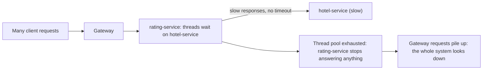

**Graceful degradation** is the goal: when part of the system fails, the rest keeps working with reduced features, not a total outage.

### 5.2 The tools
| Tool | One-line meaning | Example |
|---|---|---|
| **Timeout (TimeLimiter)** | Don't wait forever | Give up after 2 seconds |
| **Retry** | Try again for short glitches | Retry a failed call up to 3 times with backoff |
| **Circuit breaker** | Stop calling something that keeps failing | After many failures, fail instantly for a while |
| **Bulkhead** | Limit concurrent calls to one dependency, so it can't use all your threads | Max 10 concurrent hotel calls |
| **Rate limiter** | Limit calls per time period | 100 calls per second |
| **Fallback** | A backup answer when the call fails | Return "hotel details unavailable" |

### 5.3 The circuit breaker
It works like the breaker in an electrical panel: when something is faulty, it trips to protect everything else, then tests later whether the fault is gone.

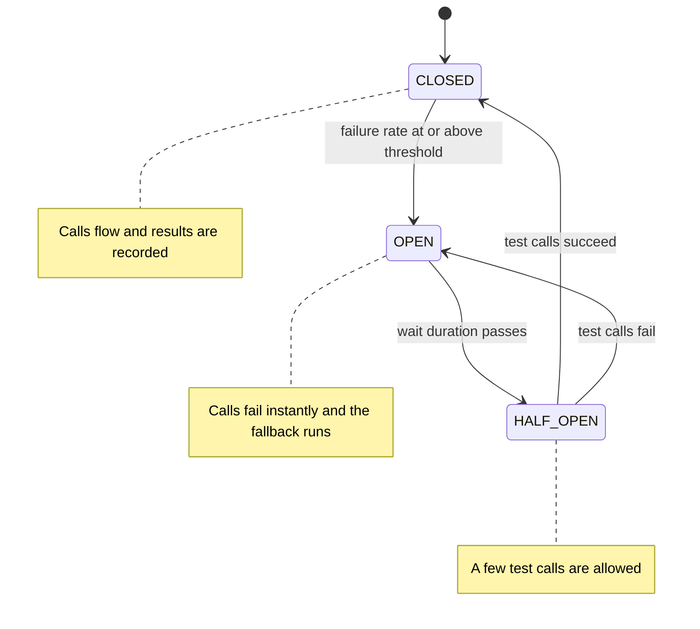

| State | Behaviour |
|---|---|
| **CLOSED** | Normal. Every call goes through. Outcomes are recorded in a sliding window |
| **OPEN** | Calls are **not made**. They fail immediately (`CallNotPermittedException`) and the fallback runs |
| **HALF-OPEN** | A limited number of test calls are allowed. Success closes the circuit, failure reopens it |

**Key settings** (per circuit breaker instance, in `resilience4j.circuitbreaker.instances.<name>`)
| Setting | Meaning |
|---|---|
| `slidingWindowSize` | How many recent calls are considered |
| `minimumNumberOfCalls` | Calls needed before the failure rate is evaluated |
| `failureRateThreshold` | Percentage of failures that opens the circuit |
| `slowCallDurationThreshold`, `slowCallRateThreshold` | Count calls slower than this as "slow", and open if too many are slow |
| `waitDurationInOpenState` | How long to stay OPEN before HALF-OPEN |
| `permittedNumberOfCallsInHalfOpenState` | Test calls allowed in HALF-OPEN |
| `recordExceptions` / `ignoreExceptions` | Which exceptions count as failures |

### 5.4 What should count as a failure
Not every error means the dependency is unhealthy. A `404 Not Found` or `400 Bad Request` is a correct answer to a bad request, so it should **not** open the circuit. Count timeouts, connection errors and `5xx` responses. Use `ignoreExceptions` for business exceptions.

### 5.5 Timeouts and slow calls
- A timeout is the first line of defence. Without it, a hung dependency blocks threads indefinitely.
- Give each call a **timeout budget** that fits the whole chain: gateway timeout > service timeout > downstream timeouts. Otherwise the outer caller gives up while inner calls keep running.
- Gotcha: the Spring Cloud CircuitBreaker integration for Resilience4j applies a **default 1 second time limit** unless you configure a `TimeLimiter`. Slow-but-working calls can fail unexpectedly if you forget this.

### 5.6 Retry
- Retry only for **temporary** failures (timeouts, connection resets, `503`), and only for **idempotent** operations.
- Use **exponential backoff with jitter** (wait 100 ms, 200 ms, 400 ms, with some randomness). Fixed instant retries from many callers cause a **retry storm** that hammers a recovering service.
- Keep attempts low (2-3). Retries multiply load: 3 attempts across 3 layers can be 27 calls.
- Don't retry on `CallNotPermittedException` (the circuit is open).

### 5.7 How the pieces combine
In Resilience4j's Spring integration, the default order from outside to inside is:
`Retry( CircuitBreaker( RateLimiter( TimeLimiter( Bulkhead( call )))))`
So **each retry attempt passes through the circuit breaker** and is counted by it. When the circuit opens, remaining retries fail fast.

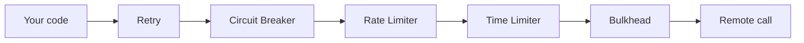

**Example: retry and circuit breaker on a failing hotel-service**
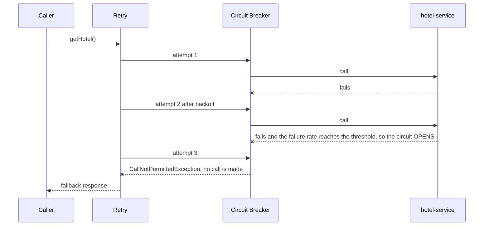

### 5.8 Fallbacks
A fallback runs when the call fails or the circuit is open. A good one returns something **honest and useful**: a partial response with a clear "unavailable" marker, a cached value, or a clean `503`. A bad one hides the failure with fake or stale data that looks real.

For Feign: enable with `spring.cloud.openfeign.circuitbreaker.enabled=true` and give the client a `fallback` or `fallbackFactory`.

### 5.9 Observing it
Actuator exposes circuit breaker state, buckets and events (for example `/actuator/circuitbreakers`, `/actuator/health`, and Micrometer metrics). In production, alert on circuits opening, because it means a dependency is in trouble.

#### 5.9.1 Reading `/actuator/circuitbreakers`
Instance names are generated per Feign method: `ClientInterface` + `methodName` + `ParamTypes` (e.g. `HotelServiceClientgetHotelByIdLong`). Each Feign method has its own breaker.

| Field | Meaning |
|---|---|
| `state` | `CLOSED` (normal), `OPEN` (calls blocked, fallback runs), `HALF_OPEN` (test calls), plus `DISABLED` / `FORCED_OPEN` (manual) |
| `bufferedCalls` | Outcomes currently in the sliding window, capped at `slidingWindowSize` |
| `failedCalls` | Buffered calls that failed (per `recordExceptions`; `ignoreExceptions` are not recorded) |
| `failureRate` | `failedCalls / bufferedCalls * 100`. **`-1.0` when `bufferedCalls < minimumNumberOfCalls`** (not enough data, not an error) |
| `failureRateThreshold` | Percentage that opens the circuit (default 50%) |
| `slowCalls` | Buffered calls slower than `slowCallDurationThreshold` (default 60s), whether they succeeded or failed |
| `slowFailedCalls` | Calls both slow and failed (subset of `slowCalls` and `failedCalls`) |
| `slowCallRate` | `slowCalls / bufferedCalls * 100`, also `-1.0` until the minimum is reached |
| `slowCallRateThreshold` | Percentage of slow calls that opens the circuit (default 100%, so slowness alone effectively never opens it) |
| `notPermittedCalls` | Cumulative count of calls rejected while OPEN (never reached the remote service) |

**Evaluation rule:** in CLOSED, once `bufferedCalls >= minimumNumberOfCalls`, the circuit opens if `failureRate >= failureRateThreshold` or `slowCallRate >= slowCallRateThreshold`. It stays OPEN for `waitDurationInOpenState`, then goes HALF_OPEN and allows `permittedNumberOfCallsInHalfOpenState` test calls, which decide CLOSED or OPEN again.

**Defaults to remember:** `slidingWindowType=COUNT_BASED`, `slidingWindowSize=100`, `minimumNumberOfCalls=100`, `failureRateThreshold=50`, `slowCallRateThreshold=100`, `slowCallDurationThreshold=60s`.

### 5.10 Where we apply it in this project
1. rating-service: Feign calls to user-service and hotel-service (the rating-details API).
2. api-gateway: a circuit breaker with a clean `503` when a service is down.
3. Two instances of a service, to see load balancing and failover.

### Pitfalls
- Default or missing timeouts.
- Retrying non-idempotent operations or retrying without backoff.
- Counting client errors (`4xx`) as failures.
- Fallbacks that return misleading data.
- A circuit breaker with a tiny window, so one failure trips it.
- Testing only the happy path. Always test by stopping or slowing the dependency.

### 5.11 Implemented: circuit breaker and fallbacks on rating-service Feign calls

**Goal:** if user-service or hotel-service is down or slow, rating-service responds quickly and sensibly, and stops hammering the broken service.

**What was built**
| Piece | Where | Purpose |
|---|---|---|
| Dependencies | `spring-cloud-starter-circuitbreaker-resilience4j`, `spring-boot-starter-actuator` | Circuit breaker support and a way to watch it |
| Config | `config-repo/rating-service.properties` | Enables it, sets timeouts and breaker rules |
| `HotelServiceClientFallbackFactory`, `UserServiceClientFallbackFactory` | `client/fallback/` | Runs when a call fails or the circuit is open |
| `fallbackFactory = ...` | on `@FeignClient` | Registers the factory (without this it never runs) |
| `ServiceUnavailableException` + handler | `exception/` | Turns "could not verify" into a clean `503` |
| `FeignException.NotFound` handler | `GlobalExceptionHandler` | Turns a remote 404 into a `404` |
| Null-data handling | `RatingServiceImpl` | Chooses degrade or fail per operation |

**Configuration used**
```properties
spring.cloud.openfeign.circuitbreaker.enabled=true
spring.cloud.openfeign.client.config.default.connect-timeout=2000
spring.cloud.openfeign.client.config.default.read-timeout=3000

resilience4j.circuitbreaker.configs.default.sliding-window-size=10
resilience4j.circuitbreaker.configs.default.minimum-number-of-calls=5
resilience4j.circuitbreaker.configs.default.failure-rate-threshold=50
resilience4j.circuitbreaker.configs.default.wait-duration-in-open-state=10s
resilience4j.circuitbreaker.configs.default.permitted-number-of-calls-in-half-open-state=3
resilience4j.circuitbreaker.configs.default.ignore-exceptions=feign.FeignException.NotFound,feign.FeignException.BadRequest

resilience4j.timelimiter.configs.default.timeout-duration=4s
```
Read it as: after at least 5 calls, if 50% or more of the last 10 failed, open the circuit for 10 s, then allow 3 test calls. Time limit (4 s) is above the Feign read timeout (3 s), which is above the connect timeout (2 s).

**What happens on a call**
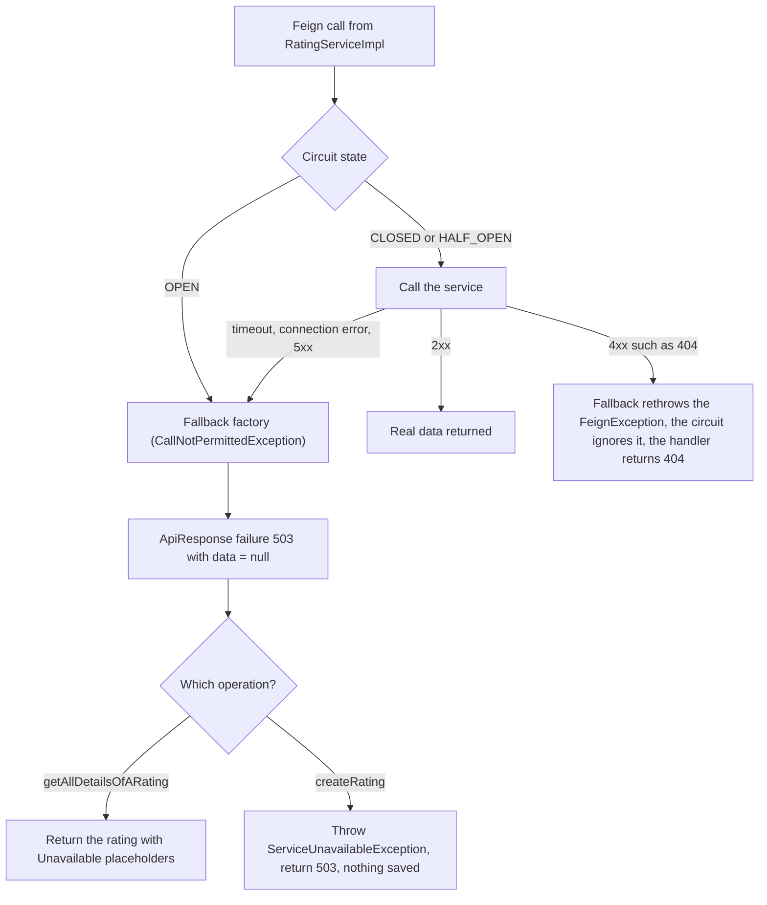

**Design decisions and why**
- **Different handling per operation.** Reading details can degrade, because a partial answer is still useful. Creating a rating must fail, because saving a rating for a user or hotel we could not verify corrupts data. A fallback must never make a failure look like a success.
- **`fallbackFactory` over `fallback`.** The factory receives the cause. Without it you cannot tell a `404` (a real answer) from an outage.
- **The fallback rethrows 4xx.** Otherwise a "hotel not found" would be hidden as "service unavailable".
- **`ignore-exceptions` for 404 and 400.** A correct "not found" must not count toward opening the circuit. This is separate from the fallback: the fallback still runs for ignored exceptions, which is why it rethrows 4xx itself.
- **The fallback returns a failure `ApiResponse` with `data = null`** (not Java `null`). The service layer checks the missing data.
- **Explicit time limiter.** The default is 1 s, which would cut off slow-but-working calls.

**Verified behaviour (manual tests)**
| Scenario | Result |
|---|---|
| All services up | Normal full response, circuit `CLOSED` |
| Hotel-service stopped, repeated calls | Fast degraded responses, then circuit `OPEN` |
| Calls while `OPEN` | Instant response, no Feign attempt made |
| Hotel-service restarted, wait 10 s | `HALF_OPEN`, then `CLOSED` |
| Rating for a non-existent hotel | `404`, circuit stays `CLOSED` |
| `createRating` while a service is down | `503`, nothing saved |

**Useful endpoints:** `/actuator/circuitbreakers` and `/actuator/circuitbreakerevents` on rating-service (`:8083`).

**Still to do:** retry with backoff (5.6), and a circuit breaker at the gateway (5.10 item 2).

---

## 6. Security (authentication and authorization)

### 6.1 What and why
- **Authentication (AuthN):** who are you? (login, proving identity)
- **Authorization (AuthZ):** what are you allowed to do? (roles, permissions, ownership)

In a monolith, one app holds a server-side session and every request is checked in one place. In microservices there is no shared session, there are many services, and services also call each other. So we need identity that **travels with the request** and can be verified by any service without calling a central session store.

### 6.2 The standard approach: tokens + OAuth2/OIDC
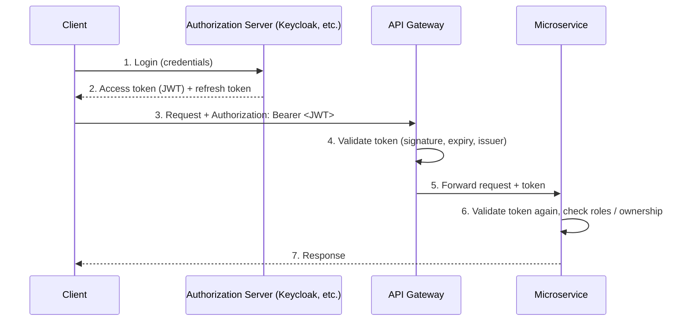
- **OAuth2** is an authorization framework (who may access what, using tokens). **OIDC** (OpenID Connect) is a layer on top that adds authentication (an ID token saying who the user is).
- **Authorization Server** logs users in and issues tokens. It is the only place that sees passwords. Examples: Keycloak, Spring Authorization Server, Auth0, Okta.
- **Resource server** = any service that accepts and validates tokens (our microservices and the gateway).
- **Access token:** short-lived (minutes). **Refresh token:** long-lived, used only to get new access tokens, never sent to services.

### 6.3 JWT (JSON Web Token)
`header.payload.signature`, each Base64URL-encoded.
- **Payload claims:** `sub` (user id), `iss` (issuer), `aud` (intended audience), `exp` (expiry), plus `roles` / `scope`.
- **Signed, not encrypted.** Anyone can read the payload, so never put secrets or sensitive data in it. The signature only proves it was not tampered with.
- **Verification is local and stateless:** the service checks the signature using the authorization server's **public key** (fetched from its JWKS endpoint), so no call is needed per request. Prefer asymmetric signing (RS256/ES256) over a shared secret (HS256), so services can verify but cannot forge tokens.
- **Trade-off:** stateless means a token cannot be easily revoked before `exp`. Mitigate with short expiry, refresh-token rotation, and (when needed) a denylist or token introspection.

### 6.4 Where to enforce
| Approach | Idea | Verdict |
|---|---|---|
| Gateway only | Gateway validates, services trust everything inside the network | Simple, but one bypass (or a compromised service) exposes everything |
| **Gateway + each service** | Gateway rejects bad tokens early and does coarse checks, each service also validates the token and does fine-grained checks | **Recommended** (defense in depth, "zero trust") |

The gateway is a convenience and first filter, not the only wall. Services must also not be reachable directly from outside.

### 6.5 Authorization levels
- **Coarse (gateway):** is the token valid? does the role allow this route? (e.g. only `ADMIN` can `DELETE /hotels/**`)
- **Role/scope based (service):** `@PreAuthorize("hasRole('ADMIN')")` (method security).
- **Ownership/data-level (service only):** a user may edit only their own rating. Only the service that owns the data can check this, so never leave it to the gateway.

### 6.6 Service-to-service calls
| Option | Use when |
|---|---|
| **Propagate the user's token** (Feign interceptor copies the `Authorization` header) | The downstream call acts on behalf of the user, so their permissions apply |
| **Client credentials grant** (the service gets its own token) | Background jobs or system calls with no user |
| **mTLS** (each service has a certificate) | Network-level identity between services, often via a service mesh |

### 6.7 What a senior engineer should know
- Never roll your own crypto or token format. Use a proven authorization server.
- Passwords live only in the authorization server. Services never see them.
- Validate `iss`, `aud`, `exp` and signature. Missing `aud` checks let a token for one service work on another.
- Short-lived access tokens, store refresh tokens carefully, use HTTPS everywhere.
- The gateway can forward the validated identity as headers, but then services must trust only the gateway. Passing the original JWT is safer.
- CORS and CSRF: bearer tokens in the `Authorization` header are not sent automatically by browsers (so CSRF risk is low), but cookie-based tokens are. CORS is configured at the gateway.
- Secrets (DB passwords, client secrets) belong in a secret store, not in the config repo in plain text.

### 6.8 Pitfalls
- Trusting the internal network and leaving services open to direct calls.
- Checking only at the gateway.
- Long-lived tokens or sensitive data in the JWT payload.
- A shared HS256 secret copied into every service.
- Skipping ownership checks (users reading or editing other users' data).
- Forgetting to propagate identity in Feign calls, so downstream services reject the request or treat it as anonymous.

### 6.9 Where we apply it in this project
To be decided and built step by step (authorization server choice, gateway validation, resource-server setup in each service, Feign token propagation).
